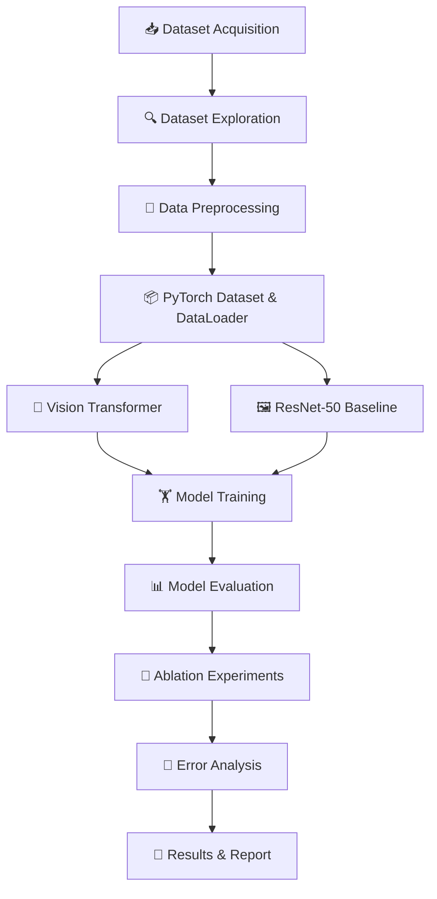

# 🧠 Vision Transformer Benchmark

<p align="center">
  
  
  
  
</p>

<p align="center">
  <b>Exploring Vision Transformers for Image Classification and Pakistan Sign Language Recognition</b>
</p>

---

## 📌 About the Project

**Vision Transformer Benchmark** is an academic deep learning project focused on understanding, implementing, and evaluating the Vision Transformer (ViT) architecture for image classification.

Unlike conventional Convolutional Neural Networks (CNNs), Vision Transformers divide images into patches and use self-attention mechanisms to learn relationships between image regions.

This project investigates ViT performance across standard image classification datasets and a local Pakistan Sign Language dataset, with ResNet-50 serving as a CNN baseline.

### 🎯 Objectives

- 🧠 Understand the Vision Transformer architecture and self-attention mechanism.
- 🛠️ Implement and evaluate ViT using PyTorch.
- 🖼️ Explore and preprocess multiple image datasets.
- 📊 Compare ViT with a ResNet-50 baseline.
- 🧪 Conduct controlled ablation experiments.
- 🤟 Explore static Pakistan Sign Language alphabet recognition.
- 📈 Analyze model performance, limitations, and misclassifications.

## 🔄 Project Workflow



## 🗂️ Datasets

The project plans to investigate three datasets.

| Dataset | Description | Intended use |
|---|---|---|
| 🐱 CIFAR-10 | 10 classes of natural images | ViT reproduction experiment |
| 🖼️ STL-10 | 10 classes of natural images | Evaluation on a new dataset |
| 🤟 UAlpha40 | Pakistan Sign Language static alphabet signs and dynamic gestures | Local sign recognition experiment |

### 1. 🐱 CIFAR-10

A standard image classification dataset containing 10 categories, including airplanes, cars, birds, cats, dogs, and ships.

🔗 **Dataset:** https://www.cs.toronto.edu/~kriz/cifar.html

### 2. 🖼️ STL-10

An image classification dataset containing 10 object categories. It provides a second benchmark for evaluating generalization to a different dataset.

🔗 **Dataset:** https://cs.stanford.edu/~acoates/stl10/

### 3. 🤟 UAlpha40 — Pakistan Sign Language

A dataset of Pakistani sign-language alphabet gestures. The initial experiment will focus on static sign images; dynamic gestures may be investigated separately if time and resources permit.

🔗 **Dataset:** https://data.mendeley.com/datasets/3pvnnckxyb/3

**Data preparation:** Dataset structure, class labels, image dimensions, class distribution, and original versus augmented samples will be inspected before training.

> Dataset licences and attribution requirements will be followed according to the original dataset publications.

## 🏗️ Vision Transformer Architecture

The ViT image-classification pipeline can be summarized as follows:


### Core components

- **Patch embedding:** Converts image patches into vector representations.
- **Positional embeddings:** Provide information about patch positions.
- **Multi-head self-attention:** Learns relationships between image patches.
- **MLP blocks:** Transform the learned feature representations.
- **Classification head:** Produces class scores for the target categories.

## ⚙️ Technology Stack

| Technology | Purpose |
|---|---|
| 🐍 Python | Programming language |
| 🔥 PyTorch | Model development and training |
| 🖼️ Torchvision | Dataset loading and image transformations |
| 📊 NumPy & Pandas | Data analysis |
| 📉 Matplotlib | Visualization and training curves |
| ☁️ Google Colab | Notebook execution and GPU access |
| 🧰 Git & GitHub | Version control and collaboration |

## 🚀 Getting Started

### Prerequisites

- Python 3.10 or a compatible environment
- Google Colab or a local Python environment
- GPU recommended for model training
- Internet access for downloading public datasets

### 1. Clone the repository

```bash
git clone https://github.com/YOUR_USERNAME/vision-transformer-benchmark.git
cd vision-transformer-benchmark
```

Replace `YOUR_USERNAME` with your GitHub username.

### 2. Install dependencies

```bash
pip install torch torchvision numpy pandas matplotlib pillow scikit-learn
```

### 3. Load CIFAR-10

```python
from torchvision import datasets

train_dataset = datasets.CIFAR10(
    root="./datasets",
    train=True,
    download=True
)

test_dataset = datasets.CIFAR10(
    root="./datasets",
    train=False,
    download=True
)

print("Training images:", len(train_dataset))
print("Testing images:", len(test_dataset))
print("Classes:", train_dataset.classes)
```

### 4. Explore the datasets

The notebook will inspect:

- 📦 Dataset sizes and class labels
- 🖼️ Sample images
- 📐 Image dimensions and channels
- ⚖️ Class distributions
- 🔍 Original and augmented images
- 📊 Summary tables and visualizations

UAlpha40 must be downloaded from its published source before it can be loaded. The notebook will document the required file structure and loading procedure.

## 📊 Experimental Plan

### 🔬 Model comparison

| Experiment | Purpose |
|---|---|
| Vision Transformer | Evaluate patch-based image representation and self-attention |
| ResNet-50 | Establish a CNN baseline |
| Pretrained vs. scratch | Investigate the effect of pretraining |
| Ablation studies | Measure the effect of individual model settings |

### 📈 Evaluation metrics

- Accuracy
- Precision
- Recall
- F1-score
- Confusion matrix
- Training and validation loss
- Training time and model complexity, where appropriate

### 🧪 Planned ablation studies

The experiments will investigate individual factors while keeping the remaining configuration fixed.

- Patch size
- Transformer depth
- Number of attention heads
- Positional embedding strategy
- Classification pooling strategy
- Data augmentation

Actual configurations and results will be documented after experiments are performed.

## 📁 Repository Structure

```text
vision-transformer-benchmark/
│
├── notebooks/
│   ├── dataset_exploration.ipynb
│   ├── vit_training.ipynb
│   └── model_evaluation.ipynb
│
├── src/
│   ├── dataset.py
│   ├── model.py
│   ├── train.py
│   └── evaluate.py
│
├── results/
│   ├── figures/
│   └── tables/
│
├── requirements.txt
├── .gitignore
└── README.md
```

This is the proposed structure and can be updated as the implementation develops.

## 🗺️ Project Roadmap

- [x] Create the GitHub repository
- [ ] Download and inspect CIFAR-10
- [ ] Download and inspect STL-10
- [ ] Download and inspect UAlpha40
- [ ] Prepare reproducible data loaders
- [ ] Implement or configure Vision Transformer
- [ ] Establish ResNet-50 baseline
- [ ] Train and evaluate both models
- [ ] Conduct ablation experiments
- [ ] Perform error analysis
- [ ] Document results and limitations
- [ ] Complete the report and presentation

## 👥 Team Members

Add the names and responsibilities of all three team members below.

| Team member | Responsibility |
|---|---|
| Member 1 | To be assigned |
| Member 2 | To be assigned |
| Member 3 | To be assigned |

All team members are expected to understand the complete workflow and contribute to implementation and experimentation.

## 📚 References

1. Dosovitskiy et al. (2021). *An Image is Worth 16x16 Words: Transformers for Image Recognition at Scale.* ICLR.
2. CIFAR-10: https://www.cs.toronto.edu/~kriz/cifar.html
3. STL-10: https://cs.stanford.edu/~acoates/stl10/
4. UAlpha40: https://data.mendeley.com/datasets/3pvnnckxyb/3
5. PyTorch documentation: https://pytorch.org/docs/stable/index.html
6. Torchvision documentation: https://pytorch.org/vision/stable/index.html

## ⚖️ Licence and Attribution

The code licence for this repository will be specified separately. External datasets remain subject to their own licence terms and attribution requirements.

## ⭐ Acknowledgements

We acknowledge the original research authors, dataset creators, and open-source contributors whose work supports this project.

---

<p align="center">
  <b>Built with 🧠, PyTorch, and curiosity about computer vision.</b>
</p>